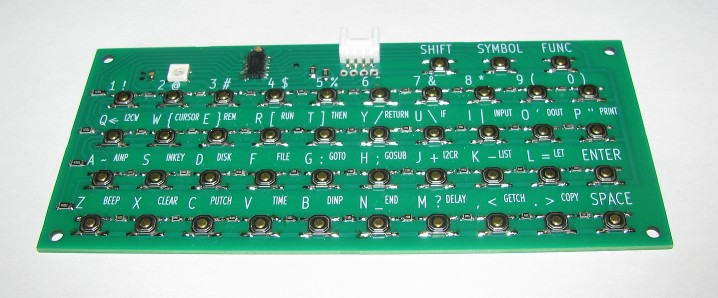
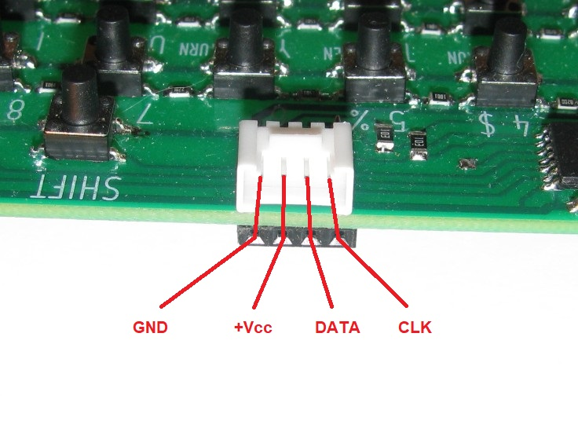
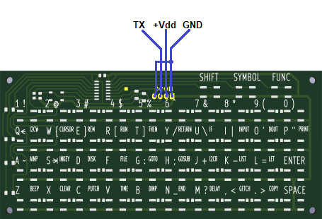
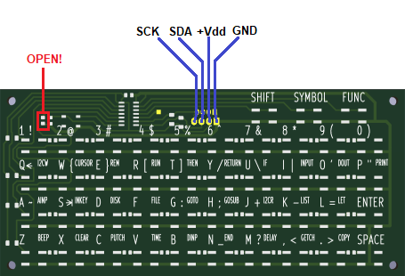

UniKeyboard - Universal Keyboard
================================

The TinyBasRV and TinyBasRO microcomputers require a keyboard for writing programs and entering data. While the TinyBasRV uses a standard PC keyboard with a PS/2 connector, the TinyBasRO uses a CardKB keyboard designed for the I2C bus.

The keyboard design described here offers an alternative if you encounter any of the following problems:

*  A PS2 keyboard for TinyBasRV is too large for your intended purpose
*  CardKB is too small (the buttons are too close together)
*  You don't have a PS2 keyboard and can't seem to find one
*  You have the same problem with CardKB
*  You have TinyBasRV and TinyBasRO microcomputers and would like to use just one keyboard for both of them

A keyboard — for which you can find the technical documentation (circuit diagram and PCB layout) in the KiCad folder — might help you resolve any of the issues mentioned above. The documentation is in version 9.0.

In the `hw_pictures` folder, you will find images for assembling the keyboard. You can mount either 5x5 mm buttons onto the board or (with a bit of skill) 6x6 mm buttons.

The keyboard uses a simple 8-bit microcontroller—the ATtiny414 or ATtiny814—and is designed for a single-sided printed circuit board. You can connect it via an HY2.0-4P Grove connector or a 4-pin female header. Alternatively, you can populate the board with both connectors:

The source code for programming the microcontroller's FLASH memory can be found in the `src` folder. It contains source programs for both Arduino (with the `megaTinyCore` library installed) and the standalone AVR-GCC compiler.

Once the microcontroller's FLASH memory has been programmed, the keyboard will operate in one of three modes:

1) UART keypad (flashes blue upon startup)
------------------------------------------

If you connect the output connector as shown in the illustration 

The keyboard will transmit data like a UART transmitter at a speed of 9600 baud, 8 bits, no parity. It can be used in various devices for entering data and commands.

2) I2C keypad (flashes red upon startup)
----------------------------------------

When connecting the keyboard according to 

the keyboard will behave like a CardKB for TinyBasRO.

3) PS/2 keyboard (flashes green upon startup)
---------------------------------------------

When connected according to the diagram and with the short R43 on the printed circuit board connected:

The keyboard will operate in PS/2 mode for TinyBasRV. Please note that in this mode, it does not respond to the initial query from the PC during the BIOS self-test. If connected to a PC, it would only establish communication if the original keyboard were removed after startup and this keyboard were subsequently connected. It will work perfectly fine with TinyBasRV; you will simply need to construct the necessary cable.

---------------------------------------------
UniKeyboard can help you if you encounter a problem with the keyboard for TinyBas microcomputers.

* * *

Univerzální klávesnice UniKeyboard
==================================

Mikropočítače TinyBasRV a TinyBasRO potřebují pro psaní programu a zadávání dat klávesnici. Zatímco u TinyBasRV je to standardní PC klávesnice s konektorem PS2, u TinyBasRO jde o klávesnici CardKB pro sběrnici I2C.

Zde popsaná konstrukce klávesnice vám přináší alternativu, pokud narazíte na některý z problémů:

*  PS2 klávesnice pro TinyBasRV je příliš velká pro váš záměr
*  CardKB je příliš malá (tlačítka má moc blízko sebe)
*  PS2 klávesnici nemáte a nedaří se ji sehnat
*  Stejný problém máte u CardKB
*  Máte oba mikropočítače a chtěli byste mít pro ně jen jednu klávesnici

S řešením některého z výše uvedených problémů by vám mohla pomoci klávesnice, jejíž technické podklady (schéma zapojení a plošný spoj) najdete ve složce KiCad. Podklady jsou ve verzi 9.0.

Ve složce hw_pictures najdete obrázky pro sestavení klávesnice. Na desku je možné osadit buď tlačítka o velikosti 5x5 mm nebo (při troše šikovnosti) tlačítka 6x6 mm.

Klávesnice používá jednoduchý osmibitový mikrořadič ATtiny414 nebo ATtiny814 a je navržena pro jednostranný plošný spoj. Můžete ji připojit přes HY2.0-4P Grove konektor nebo přes čtyřvodičový female pin strips. Případně můžete na desku osadit oba konektory:

Zdrojový kód pro naprogramování FLASH paměti mikrořadiče najdete ve složce src. Jsou zde uvedeny zdrojové programy jak pro Arduino s nainstalovanou knihovnou megaTinyCore, tak pro čistý překladač AVR-GCC.

Po naprogramování FLASH paměti mikrořadiče bude klávesnice pracovat v jednom ze tří režimů:

1) Klávesnice UART (po startu blikne modře)
-------------------------------------------

Zapojíte-li výstupní konektor podle obrázku 

bude klávesnice posílat data jako UART vysílač rychlostí 9600 Bd, 8 bitů, bez parity. Lze ji využít v různých zařízeních na vkládání dat a povelů.

2) Klávesnice I2C (po startu blikne červeně)
--------------------------------------------

Při zapojení klávesnice podle 

se bude klávesnice chovat jako CardKB pro TinyBasRO.

3) Klávesnice PS2 (po startu blikne zeleně)
-------------------------------------------

Při zapojení podle obrázku a propojení spojky na plošném spoji:

Klávesnice bude pracovat v režimu PS2 pro TinyBasRV. Pozor na to, že v tomto režimu neodpovídá na úvodní dotaz z PC v rámci testu, který provádí BIOS. S PC by komunikovala až po vytažení originální klávesnice po startu a teprve pak po jejím dodatečném připojení. S TinyBasRV bude komunikovat zcela bez problémů, jenom si musíte vyrobit potřebný kabel.

---------------------------------------------
UniKeyboard vám může pomoci, pokud budete mít problém s klávesnicí pro mikropočítače TinyBas.

